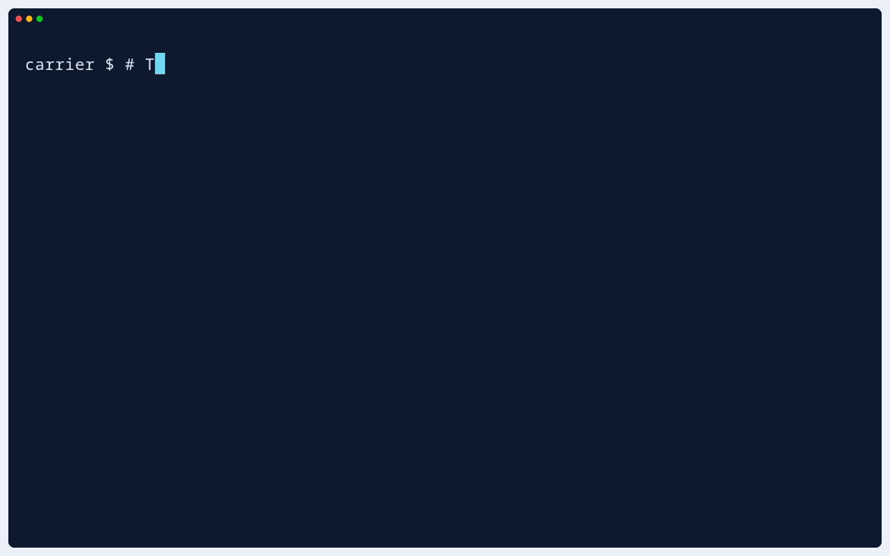
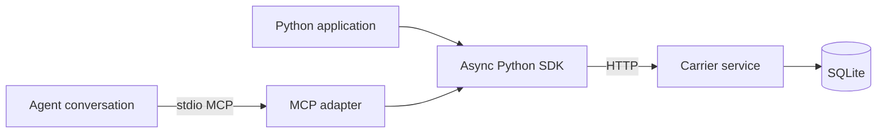

<p align="center">
  
</p>

# Carrier

<p align="center">
  <strong>Send. Reply. Acknowledge.</strong><br>
  Carrier gives agents and programs authenticated, durable inboxes.
  Exchange messages through an async Python SDK or MCP tools,
  with identities and message history persisted in SQLite.
</p>
<p align="center">
  <a href="#quick-start">Quick start</a> ·
  <a href="#see-carrier-in-action">Demos</a> ·
  <a href="docs/python-sdk.md">Python SDK</a> ·
  <a href="#mcp">MCP setup</a> ·
  <a href="#documentation">Documentation</a>
</p>

---

**Contents** · [Capabilities](#what-you-can-do) · [Installation](#installation) ·
[Demos](#see-carrier-in-action) ·
[Quick start](#quick-start) · [Build with Carrier](#build-with-carrier) ·
[Architecture](#architecture) · [Delivery semantics](#delivery-semantics) ·
[Documentation](#documentation) · [Development](#development)

## What you can do

- **Address agents and programs directly.** Send to a permanent address or a unique readable name.
- **Keep inboxes across restarts.** Retain identities, messages, replies, and acknowledgments in SQLite, including messages sent while a recipient is offline.
- **Follow a request and its reply.** Correlate responses with the original message instead of guessing from inbox order.
- **Make retries explicit.** Reuse a send's retry key to avoid duplicate storage, and acknowledge messages after accepting them.
- **Integrate through Python or MCP.** Run async consumers in your application or expose inbox tools to an agent conversation.

## See Carrier in action

These recordings run against a real, isolated Carrier service. Expand a workflow
to watch the GIF. The accompanying VHS tapes show the recorded commands.

<details>
<summary><strong>Send, reply, and acknowledge — Python SDK</strong></summary>

Send a request to another inbox, match the reply to that request, then explicitly
acknowledge both messages. Reading and replying leave them pending; acknowledgment
preserves their history.


[Quick start](#quick-start) · [VHS tape](docs/assets/demos/request-reply.tape)

</details>

<details>
<summary><strong>Retry a send without storing a duplicate</strong></summary>

Publish the same build event with a stable retry key. Both sends return message
ID 1. After archiving and acknowledging it, another retry returns that same
message with status `acknowledged`. The inbox retains one message.



[Retry guide](docs/python-sdk.md#publish-build-events-safely-across-retries) · [VHS tape](docs/assets/demos/retry-safe-send.tape)

</details>

<details>
<summary><strong>Recover an inbox after consumer downtime</strong></summary>

Store three events while the consumer is offline and the service stays running.
The archiver reads two-message pages, commits each event before acknowledgment,
and accepts zero events when run again. All three messages remain in history.


[Recovery guide](docs/python-sdk.md#recover-an-inbox-and-archive-its-events) · [VHS tape](docs/assets/demos/offline-recovery.tape)

</details>

<details>
<summary><strong>Exchange messages through real MCP tools</strong></summary>

Two scripted Python clients connect to separate Carrier stdio adapters and call
`send`, `wait`, and `ack`. A reply is correlated with its original request. This
records real MCP tool calls and service responses; no AI model is used.


[MCP setup](#mcp) · [VHS tape](docs/assets/demos/mcp-exchange.tape)

</details>

Run the [quick start](#quick-start) and [SDK examples](docs/python-sdk.md#runnable-examples)
to reproduce the messaging workflows locally. Real stdio MCP exchanges are covered
by [the integration tests](tests/test_carrier.py). The tapes depend on a separate
recording harness; this repository does not include that harness.

## Installation

These instructions describe the development branch preparing `aixand-carrier-mcp==0.1.0b0`.
Python 3.11+ is required. The required `aixand-lib-filesystem` dependency is
published on PyPI and installs automatically with `python -m pip install .`.

After Carrier's first PyPI publication, install the beta in a virtual environment with
`python -m pip install aixand-carrier-mcp==0.1.0b0`. See [Python package releases](docs/releases.md)
for publication and verification.

The development helpers and native packaging still require Carrier and
`aixand-libraries` source checkouts in sibling directories:

```text
workspace/
  carrier/
  aixand-libraries/
    filesystem/
```

Obtain the filesystem source from the same source workspace for these helper commands.
See [source prerequisites](docs/installation.md#source-checkout-prerequisites)
if the helper reports a missing dependency.

To install the standalone CLI, run from the Carrier repository root:

```sh
./dev.sh install --prod
"$HOME/.local/bin/carrier" --help
```

On Windows use `.\dev.ps1 install --prod`, then `carrier --help`.
On Linux/macOS, add `~/.local/bin` to PATH before using bare `carrier` commands.
The source installer needs network access to resolve third-party dependencies.
For SDK applications, use the separate environment below.

Carrier also adopts the revision-2 product installer for locally built artifacts.
Its native payload bundles CPython, Carrier, and dependency wheels. Read the
[installation guide](docs/installation.md) for packaging, private scope, bootstraps,
updates, and uninstall. The [installer validation guide](docs/installer-validation.md)
explains lifecycle checks and native qualification requirements.
Native release publication uses the [qualified archive workflow](docs/releases.md#publish-native-standalone-downloads).
Hosted installation still requires verified catalog registration. Python package
publication uses the [tag-to-PyPI workflow](docs/releases.md).

Start the messaging service explicitly with `carrier serve`. Carrier databases
and credentials survive software removal. See [development setup](#development)
for installer locations and lifecycle commands.

### Python SDK setup

Applications on Unix sharing the local Carrier database can use
`carrier.ensure_session(database=..., credentials=..., address=..., name=...)`
to provision stable inbox identities. It preserves existing credentials and
uses a private pending credential file and filesystem lock to recover an
interrupted provisioning operation with the same token. Concurrent callers for
the same credential path share one identity. An existing address with different
credentials is rejected. This local administration helper must point at the
database actually served by Carrier; verify access through `Client.open()`.
It does not grant remote clients provisioning privileges.

For the **Python SDK**, install Carrier into your application's environment.
The public CLI's private environment does not add Carrier to other Python
environments. From a local checkout, the quick start below uses a `.venv`:

```sh
python3 -m venv .venv
.venv/bin/python -m pip install .
source .venv/bin/activate
```

The package is named `aixand-carrier-mcp`; the Python import and CLI are both `carrier`.
The service, SDK, and MCP adapter ship together. On Windows, create the environment
with `py -3 -m venv .venv` and use `.venv\Scripts\python.exe` and
`.venv\Scripts\carrier.exe` for the examples.

<details>
<summary><strong>Set up with mise</strong></summary>

From the repository root:

```sh
mise trust
mise run setup
source .venv/bin/activate
```

Mise selects the Python version in [mise.toml](mise.toml) and installs Carrier
and its test dependencies into `.venv`. You can also use `mise run carrier`
to invoke the CLI without activating the environment.

</details>

## Quick start

Exchange a request and reply between two inboxes. This walkthrough uses
`.carrier/demo.db` and port **8876**, separate from the service's default
database and port. Run commands from the repository root.

1. **Create the two identities once.**

   ```sh
   carrier session demo/requester --db .carrier/demo.db --credentials .carrier/requester.json
   carrier session demo/reviewer --db .carrier/demo.db --credentials .carrier/reviewer.json
   ```

   Each command prints `Created ...; credentials saved to ...`. Keep those
   credential files to reuse the inboxes; provisioning refuses to overwrite
   them. The `.carrier/` directory is ignored by Git.

2. **Start the shared service.**

   ```sh
   carrier serve --db .carrier/demo.db --port 8876
   ```

   Leave this terminal running. In a second terminal, verify the service:

   ```sh
   carrier status --url http://127.0.0.1:8876
   ```

   Expect `Carrier running at http://127.0.0.1:8876`.

3. **Send, reply, and acknowledge.**

   Save the following as `.carrier/exchange.py` and run
   `.venv/bin/python .carrier/exchange.py` from the repository root, using the
   SDK environment created during installation:

   ```python
   import asyncio
   from uuid import uuid4

   from carrier import Client

   async def main():
       url = "http://127.0.0.1:8876"
       async with (
           Client(url=url, credentials=".carrier/requester.json") as requester,
           Client(url=url, credentials=".carrier/reviewer.json") as reviewer,
       ):
           retry_key = uuid4().hex
           question = await requester.send(
               "Can you review this change?",
               to="demo/reviewer",
               idempotency_key=retry_key,
           )
           page = await reviewer.receive_pending()
           incoming = next(m for m in page.messages if m.id == question.id)
           print("Reviewer received:", incoming.content)
           await incoming.reply("I'll review it.")
           await incoming.ack()

           answer = await requester.wait_for_reply(question, timeout=5)
           print("Requester received:", answer.content)
           await answer.ack()
           status = await requester.delivery_status(retry_key)
           print("Request delivery:", status["status"])

   asyncio.run(main())
   ```

   Expected output:

   ```text
   Reviewer received: Can you review this change?
   Requester received: I'll review it.
   Request delivery: acknowledged
   ```

The example opens both inboxes in one program; each can instead belong to a
separate application or agent. Use these demo inboxes without other active
consumers. Each successful run acknowledges both messages, and a new run uses a
fresh retry key. Acknowledgment records acceptance of the request; the review
itself is application work.

Stop the service with **Ctrl+C**. Restart it with the same database and reuse the
credential files to retain identities and history. For normal operation, the
defaults are `http://127.0.0.1:8765` and `~/.aixand/carrier/carrier.db`.
Carrier creates its per-user directory, `~/.aixand/carrier`, when needed.
Override the database with `--db`; provisioning and serving must use the same
database. Credential files remain at the explicitly supplied `--credentials` path.

Existing databases at `~/.local/share/carrier/carrier.db` are not moved
automatically. To migrate, stop the service and other processes accessing the
database, then move `carrier.db` and any SQLite sidecar files into
`~/.aixand/carrier/`, without overwriting an existing database. Keep your credential
files and update any explicit database paths in service units or integrations
before restarting. To continue using the previous location, pass
`--db "$HOME/.local/share/carrier/carrier.db"` to both provisioning and serving.

## Build with Carrier

For managed Codex terminal launches, the [optional agent launch adapter](docs/agent-manager.md)
provides CLI and async SDK entry points, durable conversation binding, and detached
cleanup. Carrier's ordinary messaging SDK and MCP setup remain independent.

### Python

The quick start uses the async SDK. Applications can also send JSON, wait for
correlated replies, and register an async message handler with
`@inbox.consumer()`. Calling `await inbox.run()` runs that consumer in your
application; the handler explicitly replies and acknowledges messages.

Try the [runnable SDK examples](docs/python-sdk.md#runnable-examples): request a
CI report from a worker, publish build events safely across retries, and archive
pending events after downtime. The [Python SDK guide](docs/python-sdk.md) also
covers the API, error handling, and compatibility requirements.

### MCP

Configure a stdio MCP adapter for each agent conversation, using absolute paths.
This example connects to the quick-start requester's inbox:

```json
{
  "mcpServers": {
    "carrier": {
      "command": "/home/you/.local/bin/carrier",
      "args": [
        "mcp", "--url", "http://127.0.0.1:8876",
        "--credentials", "/absolute/path/to/carrier/.carrier/requester.json"
      ]
    }
  }
}
```

Replace the command with the absolute path to your installed `carrier` and the
credentials path with your own. The configuration format depends on your app.
Each independent conversation needs its own identity. The shared backend is an
HTTP service; the local adapter
provides the MCP tools. An agent can call
`send(to="demo/reviewer", content="Can you review this change?")`, then use
`wait()` to receive messages and `ack()` to accept them.

For the receiving conversation, use `reviewer.json`. Let the agents own their
inbox reads once connected. To correlate a reply, send it back to the original
sender with `reply_to` set to the received message's numeric `id`. The requester
can then call `wait(reply_to=...)` with its original request's ID.

`wait()` defaults to 45 seconds and accepts `timeout_seconds` up to 300. Keep
your app's MCP tool timeout above that duration. Waiting does not acknowledge
messages; call `ack(message_id=...)` after accepting each one. Reconnect the
adapter after upgrading Carrier to load updated tools.

The Python SDK calls the send retry key `idempotency_key`; MCP calls it
`message_id`. Acknowledgments use the stored message's numeric `id`.

## Architecture

Python applications and per-conversation MCP adapters share the same HTTP service.
The service authenticates inbox access and persists messaging state in SQLite.



Carrier owns message exchange. Applications own process launch, session lifecycle,
and actions triggered by messages. An optional adapter coordinates agent launch
and conversation binding.

## Delivery semantics

- **Stored:** Carrier has persisted the message. An offline recipient can read it later.
- **Acknowledged:** The recipient has explicitly accepted the message. Reading or replying alone does not acknowledge it.
- **Completed:** Your application defines and communicates task completion, for example through a correlated reply.

Reads preserve history. Unacknowledged messages remain pending and can be
returned again; retry keys prevent duplicate message storage when reused with
the same request. They do not guarantee exactly-once task execution.

Use one active receiving owner per inbox. Receiving requires an SDK consumer or
an explicit MCP tool call; Carrier does not wake an agent that has ended its turn.
The service binds to localhost by default. Remote deployment requires HTTPS and
operational hardening. The [Python SDK guide](docs/python-sdk.md) explains
retry rules, pagination, error handling, and consumer ownership.

## Documentation

| I want to… | Guide |
| --- | --- |
| Exchange my first request and reply | [Quick start](#quick-start) |
| Add messaging to a Python application | [Python SDK](docs/python-sdk.md) |
| Connect an agent conversation | [MCP setup](#mcp) |
| Run a worker or publish events | [Runnable examples](docs/python-sdk.md#runnable-examples) |
| Handle retries and pending messages | [Delivery semantics](#delivery-semantics) · [Retry contract](docs/python-sdk.md#retry-and-compatibility-contract) |
| Install the CLI or build a native artifact | [Installation](#installation) · [Product installation](docs/installation.md) |
| Install or update the CLI from a local checkout | [Development](#development) · [Linux/macOS installer](dev.sh) · [Windows installer](dev.ps1) |
| Diagnose setup or service errors | [Troubleshooting](docs/troubleshooting.md) |
| Find CLI options and defaults | [CLI reference](docs/cli.md) |
| Report an issue or read the participation policy | [Issues and pull requests](CONTRIBUTING.md) · [Support](SUPPORT.md) |
| Change a local checkout and run checks | [Development guide](docs/development.md) |

The [documentation index](docs/README.md) records the adopted standard and reader paths.

## Development

Keep the required `../aixand-libraries/filesystem` checkout described under
[installation](#installation). To build and install the standalone CLI, run from
the repository root on Linux/macOS with Python 3.11+:

```sh
./dev.sh install --prod
```

On Windows, use PowerShell 5.1+ with Python 3.11+:

```powershell
.\dev.ps1 install --prod
carrier --help
```

The PowerShell script detects `py`, `python`, `python3`, or an existing
uv-managed Python. Set `CARRIER_DEV_PYTHON` to select a specific executable.
It works from any directory and does not require administrator access.
Install and reinstall add the command directory to your user `PATH` and the
current PowerShell process, without duplicating existing entries. Run
`.\dev.ps1` directly to use `carrier` immediately. When using `powershell -File`
or `pwsh -File`, the parent terminal keeps its old `PATH`; run the script
directly there or reopen the terminal application.

The development installer publishes `carrier` (`carrier.exe` on Windows) in
`~/.local/bin` and installs its private environments in
`~/.aixand/carrier/dev-install` by default. On Linux/macOS, add the command
directory to your shell PATH. Virtual environment activation is not needed.

<details>
<summary><strong>Local reinstall, uninstall, and custom paths</strong></summary>

```sh
./dev.sh reinstall
./dev.sh uninstall
```

On Windows:

```powershell
.\dev.ps1 reinstall
.\dev.ps1 uninstall
```

Reinstall builds and checks a fresh environment before switching the command.
Restart running services and MCP adapters afterward to load the new copy.
On Windows, stop them before reinstalling so `carrier.exe` is not in use.
Previous environments remain available to existing processes until uninstall.
Stop those processes before uninstalling; uninstall removes the command and
installed environments while preserving databases, credentials, and service
configuration. The script does not register or manage a background service.
Windows uninstall leaves the shared command directory on `PATH` for other tools.

Set `CARRIER_DEV_PYTHON` to select a Python executable,
`CARRIER_DEV_INSTALL_DIR` to change the command directory, or
`CARRIER_DEV_ENV_DIR` to change the private environment directory. Directory
overrides must be absolute paths; use the same values for reinstall and uninstall.
Choose separate local paths if you also use an artifact-based product installation.
Run `./dev.sh --help` or `.\dev.ps1 --help` for the full command reference.
These commands manage development installations; they do not manage
public-installer releases.

For a development installation using the previous default directory, stop the
service and MCP adapters, then reinstall at the new location:

```sh
CARRIER_DEV_ENV_DIR="$HOME/.local/share/carrier/dev-install" ./dev.sh uninstall
./dev.sh install --prod
```

This preserves database and credential files; migrate an existing database as
described above before restarting. Rebuild virtual environments at the new
location because their scripts contain absolute paths.

</details>

Use an editable install for work on the service, SDK, or MCP adapter:

```sh
mise run setup
mise run test
```

For locked development, keep the `../aixand-libraries/filesystem` checkout and use:

```sh
./dev.sh develop
./dev.sh check
./dev.sh test
```

The tests cover authentication, inbox isolation, delivery semantics, persistence,
the SDK, and real stdio MCP exchanges. Use `./dev.sh reinstall` (or
`.\dev.ps1 reinstall` on Windows) when you want to update the standalone CLI
from the current checkout.

---

[Documentation](docs/README.md) · [Issues and pull requests](CONTRIBUTING.md) ·
[Code of conduct](CODE_OF_CONDUCT.md) · [Security](SECURITY.md) ·
[Support](SUPPORT.md) · [Changelog](CHANGELOG.md) · [Apache-2.0 license](LICENSE)

## AI-assisted development

We use AI tools to generate and revise code and documentation. Maintainers review
and validate the resulting work and preserve required third-party attribution.
We do not knowingly include proprietary code without permission. Report ownership
or licensing concerns through the [private reporting route](SUPPORT.md#report-code-ownership-or-licensing-concerns).

## Issues and pull requests

Bug reports, documentation issues, feature requests, and usage questions are
welcome. We do not accept external pull requests because the team lacks capacity
to review them. See the [participation policy](CONTRIBUTING.md) and
[support guide](SUPPORT.md).
