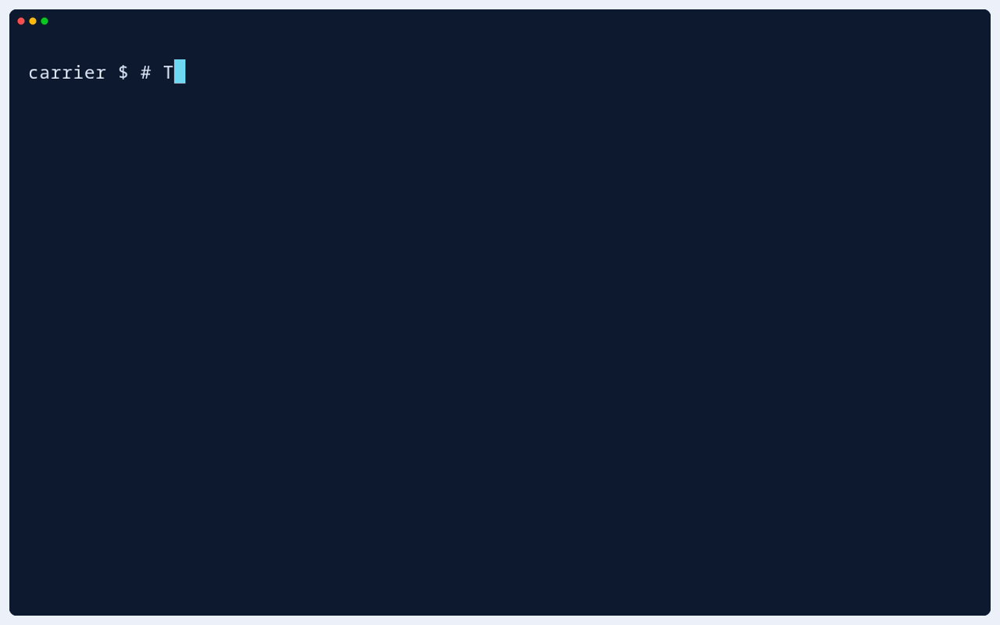

  

# Carrier

  <strong>Send. Reply. Acknowledge.</strong> 
  Carrier gives agents and programs authenticated, durable inboxes.
  Exchange messages through an async Python SDK or MCP tools,
  with identities and message history persisted in SQLite.

  <a href="#quick-start">Quick start</a> ·
  <a href="#see-carrier-in-action">Demos</a> ·
  <a href="docs/python-sdk.md">Python SDK</a> ·
  <a href="#mcp">MCP setup</a> ·
  <a href="#documentation">Documentation</a>

---

**Contents** · [Capabilities](#what-you-can-do) · [Installation](#installation) ·
[Demos](#see-carrier-in-action) ·
[Quick start](#quick-start) · [Build with Carrier](#build-with-carrier) ·
[Architecture](#architecture) · [Delivery semantics](#delivery-semantics) ·
[Documentation](#documentation) · [Development](#development)

## What you can do

- **Address agents and programs directly.** Send to a permanent address or a unique readable name.
- **Keep inboxes across restarts.** Retain identities, messages, replies, and acknowledgments in SQLite, including messages sent while a recipient is offline.
- **Follow a request and its reply.** Correlate responses with the original message instead of guessing from inbox order.
- **Make retries explicit.** Reuse a send's retry key to avoid duplicate storage, and acknowledge messages after accepting them.
- **Integrate through Python or MCP.** Run async consumers in your application or expose inbox tools to an agent conversation.

## See Carrier in action

These recordings run against a real, isolated Carrier service. Expand a workflow
to watch the GIF. The accompanying VHS tapes show the recorded commands.

<strong>Send, reply, and acknowledge — Python SDK</strong>

Send a request to another inbox, match the reply to that request, then explicitly
acknowledge both messages. Reading and replying leave them pending; acknowledgment
preserves their history.

[Quick start](#quick-start) · [VHS tape](docs/assets/demos/request-reply.tape)

<strong>Retry a send without storing a duplicate</strong>

Publish the same build event with a stable retry key. Both sends return message
ID 1. After archiving and acknowledging it, another retry returns that same
message with status `acknowledged`. The inbox retains one message.

[Retry guide](docs/python-sdk.md#publish-build-events-safely-across-retries) · [VHS tape](docs/assets/demos/retry-safe-send.tape)

<strong>Recover an inbox after consumer downtime</strong>

Store three events while the consumer is offline and the service stays running.
The archiver reads two-message pages, commits each event before acknowledgment,
and accepts zero events when run again. All three messages remain in history.

[Recovery guide](docs/python-sdk.md#recover-an-inbox-and-archive-its-events) · [VHS tape](docs/assets/demos/offline-recovery.tape)

<strong>Exchange messages through real MCP tools</strong>

Two scripted Python clients connect to separate Carrier stdio adapters and call
`send`, `wait`, and `ack`. A reply is correlated with its original request. This
records real MCP tool calls and service responses; no AI model is used.

[MCP setup](#mcp) · [VHS tape](docs/assets/demos/mcp-exchange.tape)

Run the [quick start](#quick-start) and [SDK examples](docs/python-sdk.md#runnable-examples)
to reproduce the messaging workflows locally. Real stdio MCP exchanges are covered
by [the integration tests](tests/test_carrier.py). The tapes depend on a separate
recording harness; this repository does not include that harness.

## Installation

Use [the installation guide](docs/getting-started/install.md) to choose a native
CLI/service or an SDK environment. Installing software starts no service.

### Standalone CLI and service

[Native installation](docs/getting-started/install.md#install-the-native-cli)
includes Linux/macOS and Windows commands and PATH checks.

### Source checkout

[Source prerequisites](docs/installation.md#source-checkout-prerequisites) apply
to developer helpers and packaging. Use [development CLI installation](docs/development/local-install.md)
for a standalone source command.

### Python SDK setup

Install `aixand-carrier-mcp` in [your application's environment](docs/getting-started/install.md#install-the-python-sdk).
The CLI's private runtime does not make `import carrier` available elsewhere.
Use [identity and provisioning](docs/architecture/trust.md) for stable local inboxes.

## Quick start

[Send your first request and reply](docs/quickstart.md). The walkthrough provisions
two isolated inboxes, starts the service, and verifies correlated replies and
explicit acknowledgments. For application workflows, continue with the
[example catalog](docs/examples/README.md).

## Build with Carrier

For managed Codex terminal launches, the [optional agent launch adapter](docs/agent-manager.md)
provides CLI and async SDK entry points, durable conversation binding, and detached
cleanup. Carrier's ordinary messaging SDK and MCP setup remain independent.

### Python

The quick start uses the async SDK. Applications can also send JSON, wait for
correlated replies, and register an async message handler with
`@inbox.consumer()`. Calling `await inbox.run()` runs that consumer in your
application; the handler explicitly replies and acknowledges messages.

Try the [runnable SDK examples](docs/python-sdk.md#runnable-examples): request a
CI report from a worker, publish build events safely across retries, and archive
pending events after downtime. The [Python SDK guide](docs/python-sdk.md) also
covers the API, error handling, and compatibility requirements.

### MCP

[Configure one stdio adapter per conversation](docs/guides/mcp.md), then try
[the MCP exchange](docs/examples/mcp-exchange.md). Each conversation has its own
credentials. Waits and replies leave messages pending until explicitly acknowledged.

## Architecture

Python applications and per-conversation MCP adapters share an authenticated
HTTP service backed by SQLite. Applications own receiving, side effects and
completion rules. Read [the runtime map](docs/architecture/runtime.md),
[storage](docs/architecture/storage.md) and [Manager Suite integration](docs/integrations/manager-suite.md).

## Delivery semantics

**Stored** means persisted; **acknowledged** means the recipient accepted it.
Your application defines successful work. Reads and replies preserve pending state.
Use stable retry keys and one receiving owner per inbox.
[Delivery and recovery](docs/lifecycles/delivery.md) explains the failure paths.

## Documentation

| Reader goal | Start here |
| --- | --- |
| Install and exchange a message | [Installation](docs/getting-started/install.md) · [Quick start](docs/quickstart.md) |
| Build an integration | [Python SDK](docs/python-sdk.md) · [MCP setup](docs/guides/mcp.md) |
| Learn through runnable workflows | [Example catalog](docs/examples/README.md) |
| Use Manager Suite effectively | [Ownership and examples](docs/integrations/manager-suite.md) |
| Understand the implementation | [Runtime](docs/architecture/runtime.md) · [HTTP](docs/reference/http.md) · [Storage](docs/architecture/storage.md) |
| Operate or diagnose Carrier | [Operations](docs/guides/operations.md) · [Troubleshooting](docs/troubleshooting.md) |
| Change or publish Carrier | [Development](docs/development.md) · [Releases](docs/releases.md) |

The [documentation index](docs/README.md) includes CLI, budget ingestion, policies
and maintainer references. The [project site](https://projects.aixand.org/carrier/docs/)
imports selected source pages through [publication.json](docs/publication.json).
Edit Carrier sources and resync; retain unpublished procedures and specifications.

## Development

Use [locked development setup and focused checks](docs/development.md).
For a standalone command from source, follow [development CLI installation](docs/development/local-install.md).
Public native builds and SDK environments have [separate installation paths](docs/getting-started/install.md).

---

[Documentation](docs/README.md) · [Issues and pull requests](CONTRIBUTING.md) ·
[Code of conduct](CODE_OF_CONDUCT.md) · [Security](SECURITY.md) ·
[Support](SUPPORT.md) · [Changelog](CHANGELOG.md) · [Apache-2.0 license](LICENSE)

## AI-assisted development

We use AI tools to generate and revise code and documentation. Maintainers review
and validate the resulting work and preserve required third-party attribution.
We do not knowingly include proprietary code without permission. Report ownership
or licensing concerns through the [private reporting route](SUPPORT.md#report-code-ownership-or-licensing-concerns).

## Issues and pull requests

Bug reports, documentation issues, feature requests, and usage questions are
welcome. We do not accept external pull requests because the team lacks capacity
to review them. See the [participation policy](CONTRIBUTING.md) and
[support guide](SUPPORT.md).
