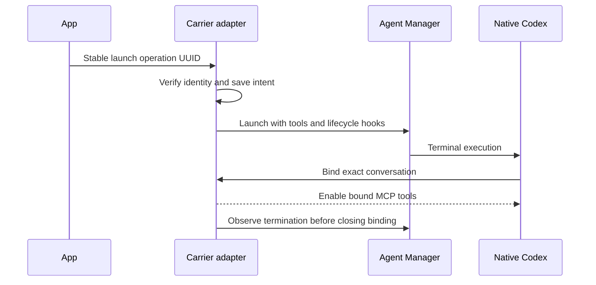

# Launch a Codex conversation with Carrier

This optional development-branch adapter connects Carrier to an Agent Manager terminal
execution SDK. The adapter provisions Carrier identities and configures messaging
tools; the runtime owns execution and session lifecycle. Carrier core runs independently.

The current implementation requires Agent Manager and its runtime
dependencies. Use the source setup below while the optional dependency metadata
retains legacy package names.



## Prepare the environment

Use Python 3.11–3.14 and the matching current source checkouts. Run from the
Carrier directory in your application's environment:

```sh
python -m pip install .
python -m pip install -e ../aixand-libraries/filesystem \
  -e ../undercurrent/python -e ../aixand-libraries/local-runtime \
  -e '../manager-suites/agent-manager[sdk]'
```

Carrier's `agent-manager` extra still declares the older distribution names
`agent-manager` and `undercurrent-sdk`. Current Manager Suite uses
`aixand-agent-manager` and `aixand-undercurrent-sdk`. The explicit source setup
above installs the current owners without selecting those legacy dependencies.
This is a packaging discrepancy; it does not establish that the published extra
resolves the current integration. Core Carrier installation is independent.

Install matching Undercurrent native binaries, start its daemon, and complete
native Codex profile setup with `agent codex onboarding`. The adapter does not
start either service or sign in. Start Carrier separately against the database
that the adapter will use:

```sh
carrier serve --db /absolute/path/carrier.db
```

New identity provisioning requires that local database and a loopback service URL.
For remote services, supply an existing private credential file instead of `--db`.
Service health is checked before local provisioning, followed by authenticated
identity verification. A failed check does not authorize replacing an identity.

## Launch or continue from the CLI

```sh
carrier agent --db /absolute/path/carrier.db codex run main
carrier agent --db /absolute/path/carrier.db codex start
carrier agent --db /absolute/path/carrier.db codex continue SESSION --profile main
```

`start` uses the runtime's account-selection policy and requires configured
profiles. `continue` requires an unambiguous retained native session reference or
UUID; it retains the captured working directory. With no execution profile, it
selects an alias of the origin environment. Use the runtime's onboarding/pickers
when interactive setup or a different profile choice is needed.

`run` and `start` accept literal native arguments after `--`. Continuation does not
accept arbitrary forwarded arguments. Add `--operation-id UUID` to reuse a launch
intent, and `--no-attach` to leave the process running without attaching its
terminal. The command prints the managed run ID and native session ID.
Closing the frontend detaches; it does not stop execution or close Carrier.

Connection options precede `codex`: `--url`, `--config` (runtime config),
`--agent-home` (runtime state), and `--integration-home` (Carrier adapter
state). The default URL is `http://127.0.0.1:8765`. Adapter state defaults to
`~/.aixand/carrier/agent-integration`, separated by runtime registry location.

## Use the async adapter

```python
from agent_manager import Client
from carrier.integrations.agent_manager import CarrierAgents

async with Client("codex") as agents:
    connected = CarrierAgents(agents, database="/absolute/path/carrier.db")
    run = await connected.spawn(profile="main", cwd=".", idempotency_key=operation_id)
    observation = await agents.execution_status(run.run_id)
```

This is an async-function excerpt. Define `operation_id` as a UUID once and save
it before dispatch. `operation_id` is a caller-created UUID. `CarrierAgents` borrows the execution SDK
client and never closes it. `spawn`, `start`, and `continue_session` return its
managed run handle. Credentials, addresses and conversation associations belong to
Carrier. Credential contents do not appear in adapter journals or launch arguments;
the native MCP command receives the credential file path.

The adapter accepts `url`, `database` or `credentials`, optional `home`, and optional
HTTP `transport`. By default a detached monitor closes the binding only after a
public runtime observation confirms termination. `monitor=False` is for
applications that explicitly own reconciliation. Call `await connected.reconcile()`
to inspect retained operations and restart missing monitors. Unknown execution
status preserves ownership and blocks tool delivery; it is not termination.

## Adopt an existing association

The old `agent ... --carrier` flag is retired. Stop the original run and inspect
its outcome before adopting its association:

```sh
carrier agent --db /absolute/path/carrier.db codex adopt NATIVE_SESSION_UUID
carrier agent --db /absolute/path/carrier.db codex continue NATIVE_SESSION_UUID --profile main
```

The SDK equivalent is `await connected.adopt_legacy(native_session_uuid)`.
Adoption authenticates the original credentials, preserves the Carrier address,
and leaves the original files untouched. Active or unconfirmed legacy runs and
conflicting destination associations are refused. Lost credentials must be
restored; adoption does not silently substitute another identity.

## Inspect uncertain work

Reuse the operation UUID or inspect `await agents.execution_status(run_id)`.
Run `carrier agent --db /absolute/path/carrier.db codex reconcile` to recover binding
monitoring. A retained run with no confirmed session can require the runtime's
normal reconciliation before `get(run_id)` returns a handle. Do not use another
operation UUID merely because a response was lost.

Binding prevents one process from switching its Carrier identity to another
conversation. A second active or unconfirmed owner is rejected. Tools remain gated
until the native lifecycle hook binds the exact conversation. Monitor and operation
journals are private files and contain credential paths; keep the adapter directory
private too.

## Verify without a real provider

Unit tests use a temporary Carrier SQLite database and HTTP application with a
fake runtime. The optional runtime qualification starts a separate runtime
daemon, a loopback Carrier service, and a fake native CLI:

```sh
python scripts/qualify_agent_integration.py --runtime-bin /absolute/path/to/runtime/bin
```

It checks native-hook binding, SDK detachment, keyed recovery and detached cleanup.
It does not use an authenticated Codex account or submit a model turn. Authenticated
Codex behavior and other providers are not established by this check; the adapter
accepts Codex terminal execution only.

Implementation: [launch adapter](../carrier/integrations/agent_manager/client.py),
[binding](../carrier/integrations/agent_manager/binding.py),
[monitor](../carrier/integrations/agent_manager/__main__.py).
