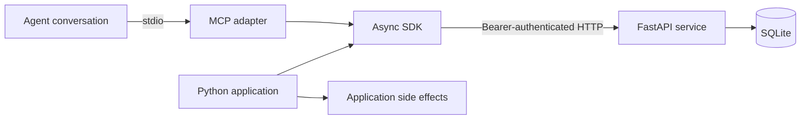

# Understand Carrier's runtime

Use this map to find the owner of a messaging or integration change. Carrier is
one Python distribution with an HTTP service, async SDK, CLI and stdio MCP adapter.

## Find the owner

| Responsibility | Source |
| --- | --- |
| HTTP validation, authentication, transactions | [service.py](../../carrier/service.py) |
| SDK polling, typed errors and consumer loop | [sdk.py](../../carrier/sdk.py) |
| Message helpers and wire conversion | [models.py](../../carrier/models.py) |
| stdio tools and optional binding gate | [adapter.py](../../carrier/adapter.py) |
| Local recoverable identity provisioning | [provision.py](../../carrier/provision.py) |
| Process entry points and defaults | [cli.py](../../carrier/cli.py) |
| Optional native-agent launch integration | [CarrierAgents](../../carrier/integrations/agent_manager/client.py) |
| Budget-event ingestion | [budget.py](../../carrier/budget.py) |

Carrier stores messages while a consumer is offline. It does not start consumers,
wake a model, schedule work or make external side effects exactly once.
Read [delivery behavior](../concepts.md), [storage](storage.md), and
[Manager Suite boundaries](../integrations/manager-suite.md).
