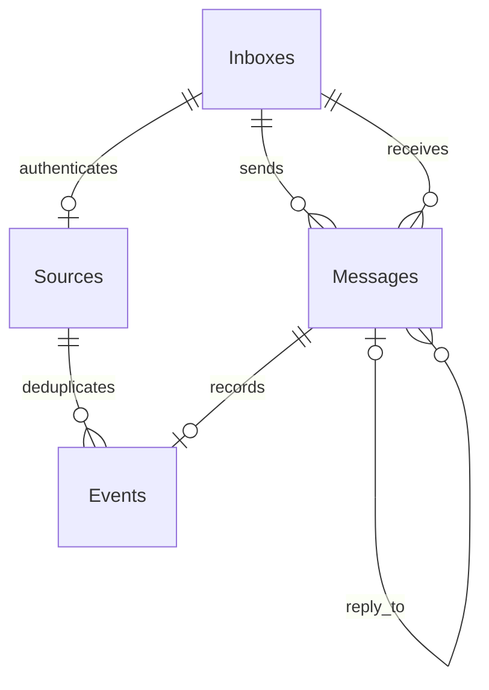

# Understand stored state

Carrier keeps inbox identities and message history in one SQLite database. The
operator selects that database; credentials remain separate private files.

| State | Meaning |
| --- | --- |
| `sessions.address` | Permanent inbox identity; exact addresses win over display names |
| `sessions.token_hash` | SHA-256 token hash; credentials hold the original bearer token |
| `sessions.recipient` | Saved default for unaddressed sends |
| `messages.id` | Database-wide numeric ID, including reply and acknowledgment references |
| `messages.message_id` | Optional caller retry key, unique per sender |
| `messages.requested_to` | Original explicit destination used to validate retries |
| `messages.reply_to` | Parent message ID; replies are ordinary stored messages |
| `messages.acknowledged_at` | Acceptance timestamp; acknowledgment retains history |
| `budget_sources`, `budget_events` | Fixed destination and source/event deduplication |

## Change or recover the database

`Store` initializes tables and adds missing columns/indexes at startup.
SQLite foreign keys are enabled per connection; mutating routes use transactions.
There is no public message deletion or retention-management command.

Stop all database writers before a filesystem backup or move. Preserve SQLite
sidecars and original credentials. Replacing the database can reuse numeric IDs;
use a new archive namespace when starting from a different backend database.
See [operations](../guides/operations.md).

Source: [Store and SQL queries](../../carrier/service.py),
[budget transaction](../../carrier/budget.py).
