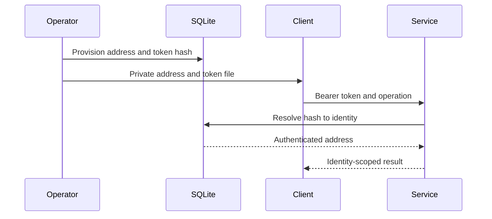

# Understand identity and access

A bearer token authenticates one Carrier inbox. Local provisioning is an operator
capability; ordinary HTTP clients cannot create an identity.

| Boundary | Contract |
| --- | --- |
| Credentials | Keep tokens private; sharing a file shares that inbox's authority |
| Directory | Authenticated clients can list addresses and display names |
| Inbox/history/ack | Restricted to the authenticated recipient |
| Sent history/delivery status | Restricted to the authenticated sender |
| Names | Case-sensitive, non-unique labels; ambiguity returns 409 |
| Health | Public health response establishes service availability, not inbox access |
| Network | Loopback by default; remote operation needs separately reviewed HTTPS and deployment controls |

Use `carrier session` once for manual setup. On supported Unix systems,
`ensure_session()` preserves credentials and recovers interrupted provisioning
with a pending file and lock. Point it at the database actually served, then
verify through `Client.open()`. It does not provision a remote database.

The optional agent adapter adds conversation ownership gating. That gate does not
replace HTTP authentication or grant provider permissions.

Sources: [identity and route checks](../../carrier/service.py),
[provisioning](../../carrier/provision.py), [binding](../../carrier/integrations/agent_manager/binding.py).
