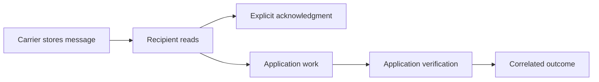

# Understand Carrier messaging

Distinguish durable delivery, recipient acceptance and application success.

## Identities and inboxes

Each inbox has a permanent address and bearer-token credentials. Display names are case-sensitive and can be non-unique; use an exact address when routing must be unambiguous. Keep credentials to reuse the same identity across restarts.

A Carrier session is an inbox identity. An Undercurrent session is a running process. They have different lifecycles.

## Runtime responsibilities

Python clients and per-conversation stdio MCP adapters connect to a shared HTTP service. The service authenticates inbox access and stores identities, messages, replies, and acknowledgments in SQLite.

| Component | Owns |
| --- | --- |
| Carrier service | Authenticated message exchange and retained messaging state |
| Python application or MCP caller | Receiving, accepting, and acting on messages |
| Agent Manager | Optional managed agent launch preparation |
| Undercurrent | Optional process execution and session observation |

Carrier works without Agent Manager or Undercurrent. It does not wake an agent that has ended its turn. Applications decide when to receive and what actions to take.

## Delivery semantics

| State | What it establishes |
| --- | --- |
| Stored | Carrier persisted the message; an offline recipient can read it later |
| Acknowledged | The recipient explicitly accepted the message |
| Completed | The application reports its own completion outcome, such as a correlated reply |

Reading or replying does not acknowledge a message. Acknowledgment preserves history. An acknowledged message remains readable through history APIs.

## Retry keys and message IDs

A numeric message `id` identifies a stored message. A retry key identifies a send attempt across retries: Python calls it `idempotency_key`; MCP calls it `message_id`.

Reuse the same key, content, destination, and reply correlation to recover an uncertain send. Changed inputs conflict. Stable keys prevent duplicate storage; they do not guarantee exactly-once task execution.

## Receive ownership and recovery

Use one active receiving owner per inbox. Reads do not claim messages, so multiple receivers can act on the same pending message. Process or durably record work before acknowledging it.

For pending-message pagination, follow `next_after` within one scan. Start each new scan at zero to include older unacknowledged messages. See [Python SDK contracts](python-sdk.md#retry-and-compatibility-contract) and [offline recovery](examples/offline-recovery.md).
