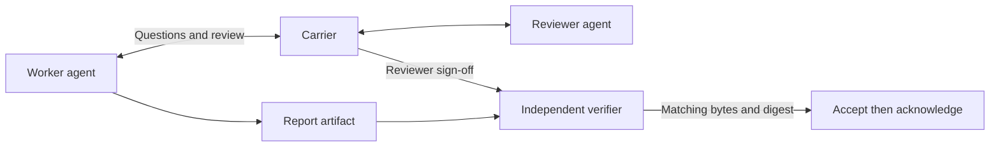

# Coordinate an agent worker and reviewer

A worker produces a revenue report. A reviewer owns its policy, answers the worker's questions, and inspects the resulting artifact. Carrier carries those exchanges; a separate Python check accepts only the exact artifact and a matching reviewer sign-off.



## Prerequisites

Complete [persistent agent setup](https://projects.aixand.org/manager-suite/examples/persistent-agents/) and [start Carrier](persistent-service.md). Use the same Python environment, runtime home, database, and service URL throughout. This example uses port 8877, the current Carrier adapter, and Codex only.

Prepare two authenticated profiles, `work` and `review`, or use existing aliases. Separate profiles created with `profile new` have separate native homes and require their own login. An alias does not isolate credentials. Save `managed_agent.py` and `review_task.py` from the [project-site downloads](https://projects.aixand.org/carrier/examples/agentic-review/) in `connected-demo`.

## Prepare a concrete task

```sh
python review_task.py prepare --task revenue-001
carrier session workflow/coordinator --db carrier.db --credentials coordinator.json
```

The new task directory contains `work/metrics.json` with gross revenue 1250.00 and refunds 75.00, plus `policy/report-policy.json`. Its policy requires subtracting refunds and formatting two decimal places. The independently checked output is exactly `Net revenue: 1175.00` followed by one newline.

Keep the same coordinator credentials on restart. The reviewer’s acceptance message will be delivered even when this Python verifier is offline.

## Launch two Carrier-connected agents

```sh
python managed_agent.py launch --state team/worker --profile work \
  --project "$PWD/revenue-001/work" --carrier-db "$PWD/carrier.db"
python managed_agent.py launch --state team/reviewer --profile review \
  --project "$PWD/revenue-001/policy" --carrier-db "$PWD/carrier.db"
```

The utility calls `CarrierAgents.spawn()` with a saved operation UUID. Carrier owns the inbox association and native lifecycle binding; Agent Manager owns profile/execution identity; Undercurrent owns the running process. The retired `agent ... --carrier` flag is not used.

Attach to each printed session ID. Complete project trust and permit the Carrier native lifecycle hook and messaging tools according to your provider policy. Detach after setup. A new native conversation can remain `pending` until its first prompt creates the conversation identity. Save `binding-check.txt` with this short request:

```plaintext
Confirm your Carrier address and available messaging tools. Do not send
messages or change files. Respond briefly.
```

Send that setup request to both ready terminals, then inspect their bindings:

```sh
python managed_agent.py send --state team/worker --message-file binding-check.txt --input-id binding
python managed_agent.py send --state team/reviewer --message-file binding-check.txt --input-id binding
```

```sh
python managed_agent.py inspect --state team/worker > worker-observation.json
python managed_agent.py inspect --state team/reviewer > reviewer-observation.json
```

Wait for the setup responses and repeat inspection if necessary. Both must report `carrier.status: bound` and `carrier.state: active`. Record their actual `carrier.address` values. Profile aliases are not inbox addresses. An unknown/unbound observation is a reason to inspect setup, not a reason to send the task to an invented address.

## Give the reviewer a decision and review loop

Save the following as `reviewer-task.txt`. Replace `WORKER_ADDRESS` with the observed address and `REPORT_PATH` with the absolute path to `revenue-001/work/report.txt`:

```text
You are the policy reviewer for task revenue-001. Read report-policy.json.
The worker at WORKER_ADDRESS owns implementation. Do not edit its files.

For at most 10 minutes, use Carrier wait to receive that worker's messages.
For a policy question, reply to its sender with reply_to set to the numeric
received message ID. Include task_id=revenue-001, the decision, and evidence
from the policy. Choose a stable message_id for each reply and reuse it only
for retries of the same exact content. Acknowledge the question after its
reply is stored.

On type=complete, read REPORT_PATH independently. Check the calculation,
formatting, and final newline, and compute SHA-256 of the actual file bytes.
If correct, reply to the worker with status=accepted and send a separate JSON
message to workflow/coordinator containing task_id="revenue-001",
status="accepted", and artifact_sha256 set to the actual file digest.
Use a stable distinct retry key for this sign-off. Acknowledge completion
only after those sends are stored. Finish after acceptance.

If incorrect, reply status=changes-requested with concrete corrections,
acknowledge that submission, and keep waiting for a corrected submission.
On missing policy, access failure, or the deadline, report blocked instead
of accepting. Receiving no message in one wait is not the end of the task.
```

Dispatch after the reviewer terminal is available:

```sh
python managed_agent.py send --state team/reviewer \
  --message-file reviewer-task.txt --input-id task
```

## Ask the worker to consult the reviewer

Save as `worker-task.txt`, replacing `REVIEWER_ADDRESS`:

```text
You own task revenue-001. Read metrics.json and produce report.txt here.
Before calculating the report, ask REVIEWER_ADDRESS over Carrier how refunds
and decimal formatting must be handled. Include task_id=revenue-001 and
operation=policy-question. Choose a stable message_id before sending.

Wait for a reply correlated to your numeric request ID. Verify its sender
and task_id, read the decision, then acknowledge the reply. Use the decision
to write report.txt and run an explicit check of its arithmetic and format.

Send type=complete, task_id=revenue-001, the absolute artifact path, its SHA-256,
and your check result to the reviewer. Choose a new stable retry key for
this submission. Wait for its correlated review. On changes-requested,
correct the report and submit a new completion message with a new key.
Acknowledge each reviewer reply after checking it, including the final
acceptance. Finish only on an accepted review. Report blocked on missing policy,
access failure, or a 10-minute deadline. Do not treat acknowledgment or
message storage as successful review. Do not commit or change other files.
```

```sh
python managed_agent.py send --state team/worker \
  --message-file worker-task.txt --input-id task
```

Carrier transports messages; each agent must actively wait/read and act on them. It does not autonomously wake an idle model or run a distributed task queue. Python SDK retry keys are `idempotency_key`; native Carrier MCP tools call the equivalent argument `message_id`.

## Verify the delivered work independently

When the reviewer reports acceptance, run this with its actual address:

```sh
python review_task.py verify --task revenue-001 --credentials coordinator.json \
  --reviewer REVIEWER_ADDRESS
```

The verifier requires exact artifact bytes, a sign-off from that reviewer, matching `task_id`, `status: accepted`, and the digest of those same bytes. It rejects a wrong artifact or missing/mismatched acceptance, retains `review-receipt.json`, and only then acknowledges the sign-off. Repeating verification rechecks the artifact and retries the same acknowledgment.

The reviewers can make mistakes. This small deterministic gate is the application's acceptance rule, independent of the model's description of its work. For another task, change the verifier to check the actual requirements rather than accepting an idle process or an optimistic summary.

## Recover and finish

Inspect the existing executions and their screens before retrying. `retry-launch` reuses the saved launch operation; resending the same task file and input ID reuses its terminal delivery ID. Neither operation invents a new task. Keep the original Carrier identities and databases. A timeout leaves both stored messages and underlying executions available.

```sh
python managed_agent.py screen --state team/worker
python managed_agent.py screen --state team/reviewer
python managed_agent.py stop --state team/worker
python managed_agent.py stop --state team/reviewer
```

Stop the shared Carrier service and isolated daemon when finished with all examples. Preserve task artifacts, execution references, and the review receipt for inspection.

## Validation

The earlier project-site walkthrough records the following live check; it is
not a fresh qualification of this documentation revision.

Tested on Linux with live Codex 0.166.0, Agent Manager 0.1.2b0, and Undercurrent/Carrier 0.1.0 beta. Two native executions exchanged a policy question and correlated answer through Carrier, produced the exact report, and delivered a reviewer sign-off whose sender and artifact digest passed the independent verifier. The live check used two executions of one authenticated profile. The offline verifier separately checks launch/input replay, native binding, and rejection of a wrong artifact or missing sign-off.

Runnable source: [review_task.py](../../examples/review_task.py).
