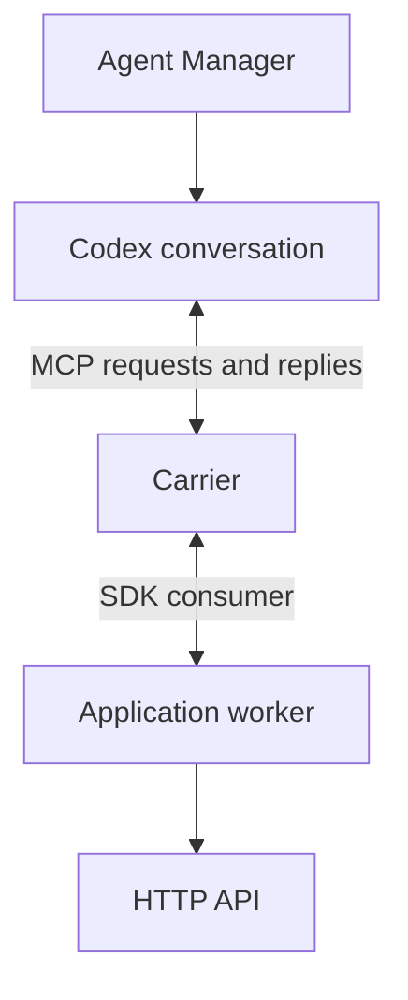

# Let a managed Codex agent call the worker

Let a native Codex conversation request work from a program through Carrier.



## Prerequisites and scope

First run the [HTTP worker](https://projects.aixand.org/undercurrent/examples/carrier-api/) and verify a Python requester receives its job ID. Keep Carrier, the API, and worker running. This walkthrough additionally requires an installed and authenticated Codex provider, an Agent Manager profile, and Carrier's optional Agent Manager adapter in your application environment. Provider turns can use your account allowance.

Install the integration from the current sibling sources into the connected environment:

```sh
python -m pip install ./aixand-libraries/local-runtime './manager-suites/agent-manager[sdk]'
```

Run that command from the parent of the sibling checkouts, then return to `connected-demo`. The current Carrier source already contains the adapter. Use [Agent Manager onboarding](https://projects.aixand.org/manager-suite/docs/guides/agent-manager/) to prepare an authenticated profile called `main`, or substitute your existing alias. Keep the same runtime home.

These live provider steps require manual verification with your account. A passing SDK fixture or a loaded terminal does not qualify a real authenticated model turn.

## Launch with the current adapter

Create a launch-operation UUID once and save it before dispatch:

```sh
python -c 'import uuid; print(uuid.uuid4())' > caller-operation.txt
carrier agent --url http://127.0.0.1:8877 --db "$PWD/carrier.db" \
  --integration-home "$PWD/caller-state" codex run main \
  --operation-id "$(cat caller-operation.txt)"
```

Do not overwrite `caller-operation.txt` when recovering this launch. Carrier provisions and owns the association; Agent Manager prepares the native profile and execution; Undercurrent owns its process. Keep the printed run and session IDs.

The archived `agent codex run main --carrier` command is retired. Carrier configuration no longer belongs in Agent Manager's provider table. The current adapter accepts Codex terminal execution; this example does not establish OpenCode adapter support.

## Bind and send a bounded request

Approve the native lifecycle hook and requested tool calls according to your configured provider policy. Confirm the conversation reports its Carrier address and available tools. Until the exact native conversation is bound, tool delivery is gated.

Give the agent this task:

```text
Send a Carrier message to services/build with JSON content:
{"operation":"build","task_id":"agent-build-001"}

Use message_id=build:agent-build-001 as the retry key. Keep the numeric
request ID. Wait for a reply correlated to that request ID. Read the result
and acknowledge the reply. Report the job ID and whether the API accepted
it. Acceptance does not prove the build finished. If waiting times out,
report the stored request ID and recover it rather than inventing a new task.
```

`message_id` is the MCP tool argument; Python sends use `idempotency_key`. Expect `job-agent-build-001` with `status: accepted`, and check `uc logs build-api --max-bytes 4096` for the matching task. An agent's prose alone is insufficient evidence that a message was sent.

## Recover and finish

Detach with Alt-U, then d. Use the printed session ID to return with `uc attach`. Closing the terminal does not stop the run. If launch status is uncertain, retain its operation UUID, inspect its existing session, and reconcile the adapter:

```sh
carrier agent --url http://127.0.0.1:8877 --db "$PWD/carrier.db" \
  --integration-home "$PWD/caller-state" codex reconcile
```

Do not create a fresh operation UUID merely because a response was lost. Stop the exact recorded execution when finished, then stop the API worker and services as described in their walkthrough. Restore original credentials if lost; do not provision a replacement identity for an uncertain run.

See [adapter configuration and recovery](../agent-manager.md) and [Agent Manager's execution contract](https://github.com/Aixand/manager-suite/blob/main/agent-manager/docs/python-sdk.md).
