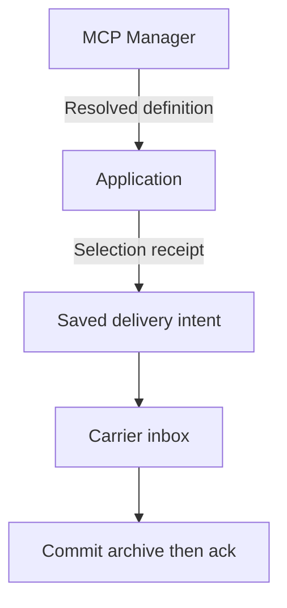

# Resolve a Carrier MCP definition

Use this pattern to hand off an explicit tool selection through Carrier.
Run from the Carrier checkout with [Manager Suite dependencies](../integrations/manager-suite.md#prepare-the-optional-examples)
and [example service setup](../guides/example-setup.md). No model account is used.



## Prepare and send

Choose a fresh work directory and a task ID for this logical handoff:

```sh
python examples/manager_handoff.py prepare --kind mcp \
  --task-id mcp-001 --work .carrier/managers/mcp-001
```

`resolved.json` contains the selected Carrier definition with absolute Python and credential paths and a 90-second tool timeout. The announced receipt has `server_started: false` and `connection_verified: false`. Resolution does not launch or connect an MCP adapter.

The command prints a numeric `message_id`, `kind: manager.mcp` and
`status: stored`. Inspect `delivery.json` in the work directory: it contains the
exact destination, content and retry key saved before sending. It contains no
Carrier token. It may contain task data, so keep it private.

## Accept the handoff

With no other consumer on `sdk/build-events`:

```sh
python examples/archive_events.py
```

For an otherwise empty inbox, expect `Accepted 1 pending event(s)`. The archive
commits the received bytes before acknowledgment. Inspect its `events.content`
column to confirm `type: manager.mcp` and the expected result above.

## Recover without repeating preparation

```sh
python examples/manager_handoff.py retry --work .carrier/managers/mcp-001
python examples/archive_events.py
```

The retry returns the original message ID and `status: acknowledged`; the second
archive run accepts zero events. If the first send failed after saving intent,
retry that same work directory with the same sender and service URL. Do not
regenerate resources or change the task merely because a response was lost.

Stop example consumers before the service. Retain the work directory, database,
credentials and archive for recovery; remove only disposable example files when
finished. For a new logical task use a new task ID and work directory.

Source: [manager handoff program](../../examples/manager_handoff.py).
