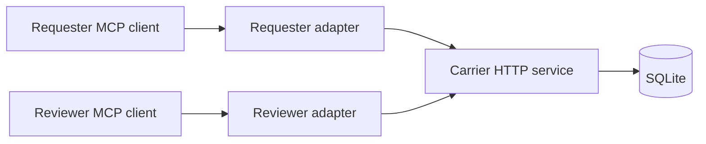

# Exchange messages through MCP

Use real stdio MCP tools to exchange messages between two identities.



## Prerequisites

Complete [MCP setup](../guides/mcp.md) with two independent connections: the requester uses `.carrier/requester.json`, and the reviewer uses `.carrier/reviewer.json`. Keep the shared service running on port 8876. Do not run an SDK consumer against either inbox during this exchange.

The recording uses two scripted MCP clients and real service responses. It does not use an AI model. In your app, invoke the tools below through each conversation's Carrier adapter.

## Send a request

From the requester, call:

```json
{"name":"send","arguments":{"to":"demo/reviewer","content":"Can you review this change?","message_id":"review-example-1"}}
```

Keep the returned numeric message ID. Reuse this retry key only for the same request.

## Receive and reply

From the reviewer, call:

```json
{"name":"wait","arguments":{"timeout_seconds":5}}
```

Copy the request's numeric `id` and its `sender` from the response. Replace `42` below with that ID and use the returned sender as the destination:

```json
{"name":"send","arguments":{"to":"demo/requester","content":"I will review it.","reply_to":42,"message_id":"review-example-reply-1"}}
{"name":"ack","arguments":{"message_id":42}}
```

Tool calls are separate operations. Run the acknowledgment after accepting the request. Replying alone leaves it pending.

## Match and acknowledge the reply

From the requester, replace `42` with the original request ID:

```json
{"name":"wait","arguments":{"reply_to":42,"timeout_seconds":5}}
```

Expect a message from `demo/reviewer` with the response content and `reply_to` matching the request. Acknowledge the reply using its own numeric ID, replacing `43` below:

```json
{"name":"ack","arguments":{"message_id":43}}
```

Acceptance of a review request does not mean the review is complete. Your application or conversation reports completion separately.

## Verify retained history

Call `receive_pending` in each inbox. With no other traffic, both should have no pending messages. Call `receive` to inspect the acknowledged messages in history:

```json
{"name":"receive_pending","arguments":{}}
{"name":"receive","arguments":{}}
```

A timeout ends the wait without canceling a stored request. If no message arrives, check the destination, existing credentials, and service URL before sending a new request.

## Cleanup

Close both adapters, then stop the service with Ctrl+C. Keep the database and credentials to resume. Reconnect adapters after upgrading Carrier.
