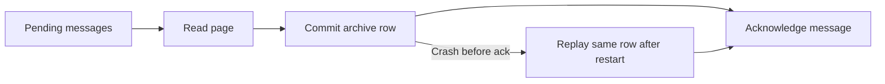

# Recover an inbox after downtime

Catch up a recipient after downtime with a durable acceptance record.



## Prerequisites

Complete the [shared example setup](../guides/example-setup.md). Keep the service on port 8877 running, activate the SDK environment in each terminal, and run commands from the Carrier repository root. The scripts are in its `examples/` directory; the project site also provides matching downloads. Use fresh example inboxes for the stated counts.

## Run the workflow

Use this pattern for a local event journal or an integration that catches up
after downtime. It saves each message into a separate SQLite archive and commits
that transaction **before** acknowledging the Carrier message.

First publish one event into a fresh example inbox, then archive it:

```sh
python examples/publish_build_event.py build-1842 --status passed
```

Run the archiver:

```sh
python examples/archive_events.py
```

For a fresh example inbox, expect:

```text
Accepted 1 pending event(s); archive: .carrier/sdk/event-archive.db
```

Run it again and the count is zero. Repeating the publisher's original command
reports that same message as `acknowledged`; it does not enqueue a new event.
The archive preserves the sender, content, timestamp, and Carrier message ID.

To exercise pagination, publish three new builds and use two-message pages:

```sh
python examples/publish_build_event.py build-1843
python examples/publish_build_event.py build-1844 --status failed
python examples/publish_build_event.py build-1845
python examples/archive_events.py --page-size 2
```

Expect `Accepted 3 pending event(s)` on the final run. The archiver follows
`next_after` within that scan and starts at zero on each new invocation. It does
not persist the pending-page cursor, so an older unacknowledged message is still
eligible after recovery.

The archive key combines the backend URL, inbox address, and message ID. If the
process stops after committing the row but before acknowledging it, the next run
finds the same pending message, reuses the archived row, and acknowledges it.
Keep using the same archive and backend database across restarts; if you replace
the backend database, choose a fresh `--archive` path because IDs may be reused.

This example makes local archive inserts safe to repeat. Carrier cannot make
unrelated API calls or other application side effects exactly once. For those,
use the destination's own idempotency support or a durable record of work.

## Cleanup and resume

Stop any worker with Ctrl+C, then stop the service. Keep `.carrier/sdk/` to retain credentials, messages, and the archive. Reuse those identities instead of provisioning replacements. If service or authentication checks fail, follow [troubleshooting](../troubleshooting.md).

Runnable source: [archive_events.py](../../examples/archive_events.py).
