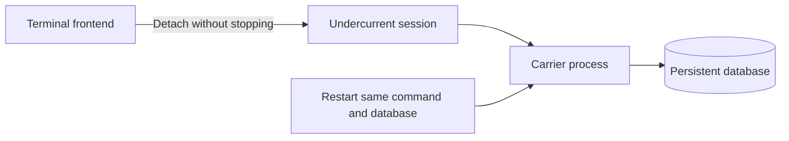

# Keep Carrier running with Undercurrent

Keep Carrier running after terminal detachment and reuse its database on restart.



## Prerequisites

Complete [connected example setup](https://projects.aixand.org/undercurrent/docs/guides/connected-examples/). Run in its `connected-demo` directory with the same Python environment and runtime home. Use a free port 8877 and an unused session name. The CLI and service must use the same database.

## Start the service

Provision these two identities once, then run the backend in Undercurrent:

```sh
carrier session sdk/requester --db carrier.db --credentials requester.json
carrier session services/build --db carrier.db --credentials api-worker.json
uc start carrier-demo -- carrier serve --db "$PWD/carrier.db" --port 8877
carrier status --url http://127.0.0.1:8877
carrier check --url http://127.0.0.1:8877 --credentials requester.json
```

Wait for the status check to succeed before starting consumers. If startup fails, inspect the session rather than launching another backend against the same database or port:

```sh
uc inspect carrier-demo
uc logs carrier-demo --max-bytes 4096
```

## Leave and return

```sh
uc attach carrier-demo
```

Press **Alt-U**, release it, then press **d** to detach. The service remains running. This preserves a process after terminal detachment; automatic startup after reboot is separate configuration.

## Restart without replacing identities

```sh
uc restart carrier-demo --graceful
carrier status --url http://127.0.0.1:8877
carrier check --url http://127.0.0.1:8877 --credentials requester.json
```

Retry the status check until startup finishes. Reusing `carrier.db` preserves inboxes, pending messages, and acknowledgments. Keep the original credential files; do not rerun identity provisioning on restart. Interrupted clients must reconnect explicitly; Carrier does not restart consumers or perform application retries.

## Put the service to work

Continue with the [HTTP worker](https://projects.aixand.org/undercurrent/examples/carrier-api/) or [CSV audit](https://projects.aixand.org/manager-suite/examples/audit-to-inbox/). One active consumer owns each inbox. A stored message does not establish that a worker is available or that a task succeeded.

## Stop

Stop workers first, then this service:

```sh
uc stop carrier-demo --graceful
```

Keep the database and credentials for the next run. Verify recovery by starting the saved service again and authenticating with the original requester file.
