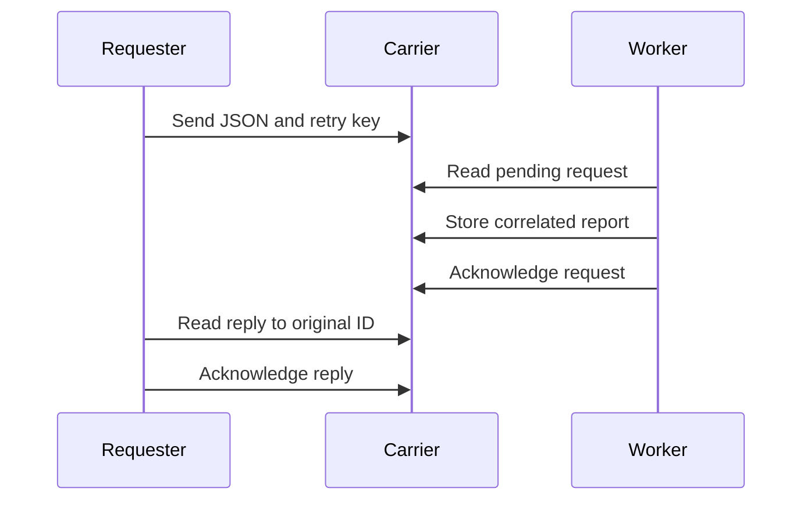

# Request a CI report

Ask a program for a report and verify the reply to your original request.



## Prerequisites

Complete the [shared example setup](../guides/example-setup.md). Keep the service on port 8877 running, activate the SDK environment in each terminal, and run commands from the Carrier repository root. The scripts are in its `examples/` directory; the project site also provides matching downloads. Use fresh example inboxes for the stated counts.

## Run the workflow

Use this pattern when a dashboard, coordinator, or agent-facing application needs
a result from another program. The worker returns a summary of named CI checks;
the requester waits for the reply to its specific message.

In a second terminal, start the worker:

```sh
python examples/report_worker.py
```

Expect `Listening as sdk/report-worker; press Ctrl+C to stop.` Leave it running.
In a third terminal, request a report:

```sh
python examples/request_report.py --build-id build-1842
```

The requester sends sample lint, unit, and integration check results and prints:

```json
{
  "build_id": "build-1842",
  "checks": 3,
  "failed": [
    "integration"
  ],
  "status": "failed"
}
```

The sample contains one failed check, so `failed` is the report's expected result.
Replace the `checks` mapping in the requester with results from your own CI job.

With a connected client named `inbox`, the core calls inside an async function are:

```python
question = await inbox.send_json(
    {"build_id": "build-1842", "checks": {"lint": "passed", "integration": "failed"}},
    to="sdk/report-worker",
)
answer = await inbox.wait_for_reply(question, timeout=30)
print(answer.json())
await answer.ack()
```

The full requester also supplies a retry key for its send. The worker registers
an `@inbox.consumer()` handler, sends `message.reply_json()`, and explicitly calls
`message.ack()`. `await inbox.run()` keeps receiving until stopped. The requester
acknowledges the reply after displaying it. The worker's reply key is derived
from the incoming numeric message ID, so retrying that handler with the same
report does not store a second reply.

To try offline delivery, stop the worker with Ctrl+C, run another request, then
restart the worker before the requester's 30-second deadline. The stored request
is still available. `--timeout 5` gives a shorter wait; a timeout ends the local
wait without canceling the stored request. It prints the request ID so you can
later inspect `receive(reply_to=...)` history. Each invocation creates a new
request and retry key; rerunning this script is a new request, not recovery of
the previous one. The next example shows how to reuse a key across invocations.

## Cleanup and resume

Stop any worker with Ctrl+C, then stop the service. Keep `.carrier/sdk/` to retain credentials, messages, and the archive. Reuse those identities instead of provisioning replacements. If service or authentication checks fail, follow [troubleshooting](../troubleshooting.md).

Runnable source: [request_report.py](../../examples/request_report.py) · [report_worker.py](../../examples/report_worker.py).
