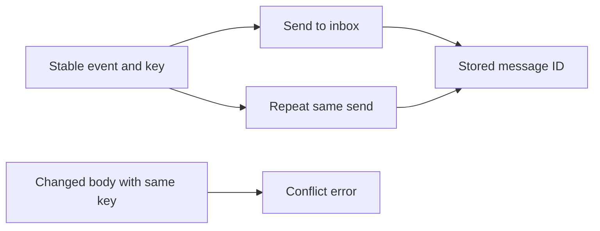

# Retry a build event safely

Recover a producer send without storing a second event.



## Prerequisites

Complete the [shared example setup](../guides/example-setup.md). Keep the service on port 8877 running, activate the SDK environment in each terminal, and run commands from the Carrier repository root. The scripts are in its `examples/` directory; the project site also provides matching downloads. Use fresh example inboxes for the stated counts.

## Run the workflow

Use this pattern for CI notifications or application events whose recipients may
be offline. The build system supplies a stable build ID, allowing a restarted
producer to reconstruct the same event key and payload.

No event consumer needs to be running. Publish the same completed build twice:

```sh
python examples/publish_build_event.py build-1842 --status passed
python examples/publish_build_event.py build-1842 --status passed
```

Both calls print the **same numeric message ID** with status `stored`. Only one
message is stored in `sdk/build-events`. The key is `build.finished:build-1842`;
it is independent of the report requests from the previous example.

Inside the publisher's async function, the SDK calls are:

```python
key = "build.finished:build-1842"
message = await inbox.send_json(
    {"type": "build.finished", "build_id": "build-1842", "status": "passed"},
    to="sdk/build-events",
    idempotency_key=key,
)
status = await inbox.delivery_status(key)
print(message.id, status["status"])
```

If a transport error leaves delivery uncertain, rerun the
same command with the same credentials, build ID, status, and recipient. The
script reports the uncertainty; the SDK does not automatically replay the send.
Changing the status for an existing key produces a `ConflictError`, which the
script explains. Use a new build ID for a new event.

Keep the payload stable on retries: adding the current time or generating a new
key on every invocation would change this behavior. In an application, retain
the original event data in your own durable storage. `stored` confirms Carrier
has the event; it does not mean a recipient has handled it.

## Cleanup and resume

Stop any worker with Ctrl+C, then stop the service. Keep `.carrier/sdk/` to retain credentials, messages, and the archive. Reuse those identities instead of provisioning replacements. If service or authentication checks fail, follow [troubleshooting](../troubleshooting.md).

Runnable source: [publish_build_event.py](../../examples/publish_build_event.py).
