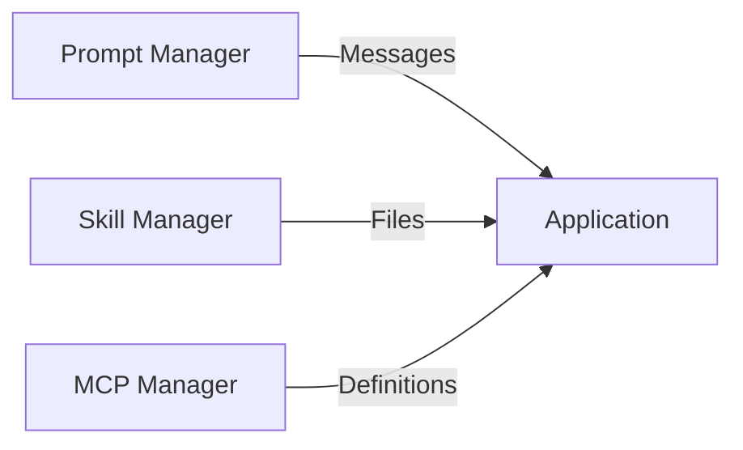
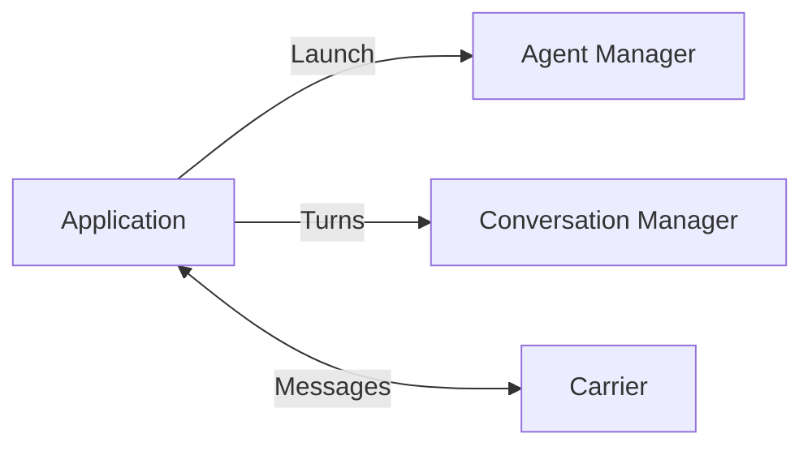

# Integrate Carrier with Manager Suite

Use Carrier to carry requests, results and acceptance between components. Manager
Suite supplies independent resource and execution libraries; your application
chooses how to compose them.



Execution and messaging have separate owners:



| Component | Owns | Try |
| --- | --- | --- |
| Prompt Manager | Owned prompts and rendered content | [Send a rendered request](../examples/prompt-handoff.md) |
| Skill Manager | Accepted skill files and reviewed project connections | [Deliver a verified skill result](../examples/skill-result.md) |
| MCP Manager | Definitions and resolution; resolution alone starts no server | [Resolve a Carrier definition](../examples/mcp-definition.md) |
| Conversation Manager | Retained conversation and turn events | [Publish completed fixture-turn evidence](../examples/conversation-result.md) |
| Agent Manager | Provider profiles and native execution | [Codex adapter](../agent-manager.md) · [Worker and reviewer](../examples/agentic-review.md) |
| Carrier | Identities, messages, correlation and acknowledgment | [Delivery lifecycle](../lifecycles/delivery.md) |

## Choose the receiving owner

An application can consume an inbox and deliver accepted input to a conversation,
or an agent can read through Carrier MCP tools. Do not independently run both
against the same inbox. Neither Carrier nor a resolved MCP definition wakes an
idle model.

The current `CarrierAgents` adapter is for Codex terminal execution. It is separate
from Conversation Manager's retained chat API. Do not pass a conversation ID where
an Agent Manager run ID or Carrier numeric message ID is required.

## Prepare the optional examples

Run from a Carrier checkout. Keep the current Manager Suite source checkout next
to it as `manager-suites` (the repository is named `Aixand/manager-suite`). Install
only the packages needed for your selected example into your SDK environment:

```sh
python -m pip install -e ../manager-suites/prompt-manager   -e ../manager-suites/skill-manager -e ../manager-suites/mcp-manager   -e ../manager-suites/conversation-manager
```

These four examples use current public APIs and need no authenticated provider.
The conversation example uses its built-in injected fixture. Agent launch requires
its [additional runtime setup](../agent-manager.md#prepare-the-environment).
Use [example setup](../guides/example-setup.md) for the local messaging service.

Owners: [Manager Suite source](https://github.com/Aixand/manager-suite),
[Carrier adapter](../../carrier/integrations/agent_manager/client.py),
[runnable handoff](../../examples/manager_handoff.py).
