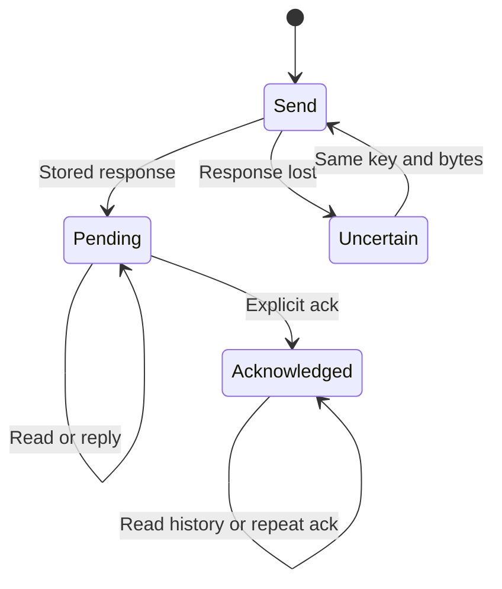

# Follow delivery and recovery

Use this lifecycle when deciding when to retry, persist an application result or
acknowledge a message. Carrier records storage and acceptance; your application
records successful work.

## Recover the right operation

| Observation | Next action |
| --- | --- |
| Send response lost | Retry the same sender, destination, body, correlation and key |
| Same key returns 409 | Compare original intent; do not silently change its payload |
| Reply wait times out | Inspect the original request and correlated history; timeout does not cancel it |
| Reply already acknowledged | Use `receive(reply_to=request.id)`; `wait_for_reply` reads pending replies |
| Handler fails | Fix the failure and resume with the same identity; deduplicate side effects |
| Ack response lost | Repeat acknowledgment using the same numeric ID |
| Pending page ends | Start the next new scan at zero; do not retain a high-water cursor |

A reply is a separate message. Send it with its own stable retry key and
`reply_to` set to the original request ID. Replying does not acknowledge either
message. Validate the expected sender and application task ID before accepting a
result; correlation alone does not encode a business success rule.

## Keep one receiving owner

The SDK processes one message at a time. Returning from a handler without
`message.ack()` raises `UnacknowledgedMessage`. Handler exceptions and cancellation
stop consumption. A confirmed acknowledgment is not undone by a later failure.
Reads do not lease or claim work: independent consumers can observe the same row.

The [archiver](../examples/offline-recovery.md) demonstrates commit-before-ack.
For external side effects, use the destination's idempotency support or an
application journal. Carrier has no distributed worker leases or automatic
mutation replay.

Sources: [consumer loop](../../carrier/sdk.py), [transaction and retry checks](../../carrier/service.py).
