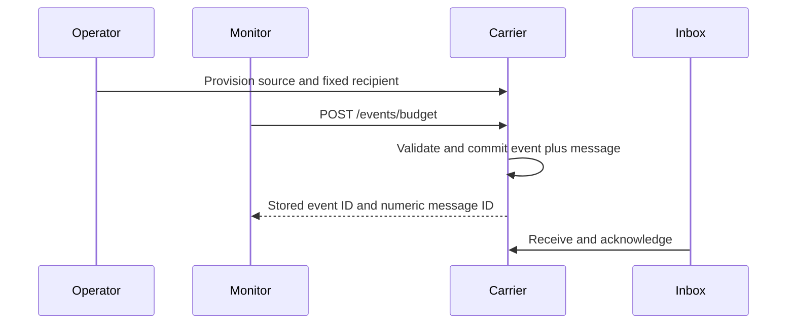

# Receive fixed-route budget events

Use these endpoints when an external budget monitor publishes events into a
Carrier inbox. Carrier accepts and stores events; it does not poll providers,
calculate allowances or choose thresholds.



## Provision the route

From the Carrier checkout, after [example setup](../guides/example-setup.md):

```sh
carrier budget-source monitor/demo --to sdk/build-events   --db .carrier/sdk/carrier.db --credentials .carrier/sdk/budget.json
carrier check --url http://127.0.0.1:8877   --credentials .carrier/sdk/budget.json --budget-source
```

Run provisioning once. `--to` must be an existing exact address. Keep the source
credentials private; their route is established locally.

## Submit an event

`GET /budget-source` authenticates the source and returns `address` and `recipient`.
`POST /events/budget` requires that source's bearer token. An ordinary identity
returns 403. The event has these fields:

| Field | Contract |
| --- | --- |
| `event_id` | 1–193 characters; stable per source and event |
| `source_id` | Must equal the authenticated source address |
| `event` | `budget.test` or `budget.threshold_crossed` |
| `auth_profile` | Nonempty producer-supplied profile string, up to 200 characters |
| `observed_at` | Nonnegative numeric timestamp supplied by the producer |
| Test event | `test: true` |
| Threshold event | `test: false`, `window: weekly`, nonempty `bucket`, thresholds and `remaining_percent` |
| `thresholds` | 1–101 values in 0–100; each must be at least `remaining_percent` |
| `remaining_percent` | 0–100 |
| `resets_at` | Optional nonnegative numeric timestamp |

Unknown fields and nonfinite numbers are rejected. Successful ingestion returns
`status: stored`, the event ID and numeric message ID. Repeating the same source,
event ID and normalized payload returns the same message. Changed payload returns
409. Ingestion does not acknowledge the recipient's message.

The source identity uses ordinary inbox credentials internally; its fixed route
is enforced by these budget endpoints, not a general restriction on all ordinary
Carrier messaging operations.

## Current integrator scope

The current Manager Suite checkout has no `agent_manager.watch` module. Carrier's
older optional default-destination test skips when that module is absent. The
HTTP ingestion and fixed-route contracts are independently tested; these docs do
not promise a current automatic Manager Suite budget-monitor command.

Source: [schema and transaction](../../carrier/budget.py),
[provisioning CLI](../../carrier/cli.py), [budget tests](../../tests/test_budget.py).
